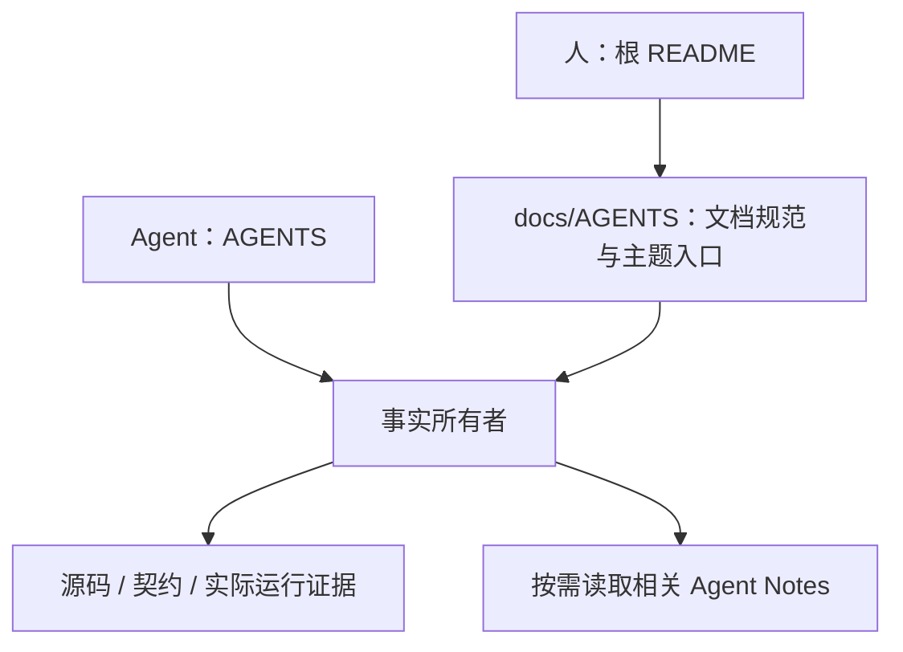

# 决策记录：采用轻量、零依赖的文档系统

Status: implemented

## 问题

Locus 需要让人与 Agent 以相同的事实边界协作：方案、已实现行为与待决问题不能相互冒充。建立这套机制时，仓库尚无 `package.json` 和业务源码，已有产品约束与讨论不能被当作可运行能力。

参考材料提供了 Python starter、模板和生命周期做法，也包含翻译、站点和封存机制。直接搬入会先承担与当前需求无关的复杂度，还可能把提炼包新增结构误认为上游要求。项目已选择 Node.js 24/26，需要无需额外运行时或依赖安装的维护方式。

## 决定

以 Markdown 维护正文，按主题和事实所有者组织，通过普通相对链接查阅。设计方案和长期理由由 Agent Notes 一并承载，不另设设计正文与索引。记录按实际实施状态使用对应生命周期，不把已确定但未实施的方案标为已交付。

Node.js 内置库实现文档检查，由根 `package.json` 提供 `pnpm docs:check` 和 `pnpm docs:test`。检查器不生成正文或索引，不引入第三方运行时依赖，也不以共享 skill 为运行前提。

## 阅读链路

人和 Agent 使用同一份正文，入口不因读者不同而维护内容副本。新增页面从所属主题建立链接，不维护第二份登记清单。

[文档规范](../../../../docs/AGENTS.md)定义结构、归属和写作规则，[开发与验证](../../../../docs/development.md)定义日常操作，[维护脚本](../../../../scripts/README.md)定义检查器的使用、范围和限制。普通参数、操作说明和产品契约仍由各自所有者维护，不在本记录复制。

## 检查边界

检查入口只读，覆盖现有维护范围内的 Markdown 结构、本地文件链接与标题锚点，以及 Agent Notes 格式。新模块的 Markdown 自动受检，无需逐页登记。

Agent Notes 的路径、生命周期和类别按封闭集合校验：只允许 `proposed`、`implemented`、`rejected`、`archived` 以及六个类别目录；生命周期根只允许 `AGENTS.md`，类别目录不再嵌套子目录，并拒绝集中索引和散落记录。

检查器只覆盖明确的 Markdown 子集，不等同于完整 CommonMark 解析。归档只检查身份元数据，跳过正文和旧出链；活动页面指向归档的链接仍检查目标与锚点。归档冻结依靠审阅和版本历史，没有哈希封存或自动防篡改保证。

## 备选方案

**直接搬入 Python starter。** 可以复用参考材料的实现，但增加 Python 运行要求，还需裁剪当前不需要的机制。提炼包是二次设计，不能据此推导上游要求或本项目必须采用的目录布局。

**仅维护 Markdown。** 起步直接、工具最少，但失效链接和记录状态只能逐次人工排查，缺少便宜且可重复的机械反馈。

**Markdown 加原生 Node.js 检查。** 与项目运行时一致，不需要额外依赖，能够检查容易漂移的结构。采用此方案，同时承担维护受限解析器的成本。

## 后果

正文、方案和理由各有可发现的维护位置，机械检查可以重复执行，文档工具不依赖临时参考包。省去强制翻译配对、网站、远端 CI、业务 API 生成和封存哈希，不为尚无真实内容的目录建立空壳文档。

事实是否真实、方案是否交付、步骤是否可执行、备选方案是否有根据，以及遗漏的新接口是否需要文档，仍需实现、运行证据与人工审阅判断。检查通过不证明这些内容正确，未验证范围必须如实说明。

只有实际维护需求能够说明收益时才扩展工具；结构或规则来自参考材料本身，不是引入它们的理由。

## 参考来源

文档标准与 Agent Notes 生命周期参考 [DeepSeek Harness 文档规范](https://github.com/deepseek-ai/deepseek-harness/blob/master/docs/AGENTS.md)及 [Agent Notes 说明](https://github.com/deepseek-ai/deepseek-harness/blob/master/.agents/notes/README.zh.md)。提炼包的 starter 是独立示例实现，不代表上游目录要求，也不是本项目的运行依赖。
