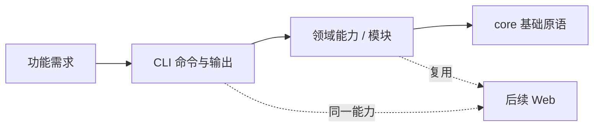

# 决策记录：CLI 优先与领域模块的自上而下推导

Status: rejected — CLI 先定六域命令再推导模型的方案由[产品切片](../../archived/feature/2026-11-08-workspace-capability-slice.md)与[组件设计](../../archived/architecture/2026-11-08-workspace-capability-composition.md)取代，薄交互层原则继续保留

## 问题

首版需要尽快验证六个 P0 产品域的真实链路，Web 界面后置。CLI 与未来的 Web 必须共用领域能力，否则会出现两套业务规则、两套状态处理，最终无法保证同一操作在不同入口得到一致结果。

当前 `packages/cli` 只有 `version` 命令和手写参数判断，没有命令树、领域分组、机器可读输出或共享能力边界。若继续把所有逻辑堆进入口插件，CLI 会变成第二个 Core；若先按 Core、插件、原语切模块，又会回到抽象先行。

需要固定一条自上而下的推导顺序，并明确 CLI 只承担应用层职责。

## 提案

### 推导顺序

功能需求 → CLI 命令与输出 → 领域能力/模块 → core 基础原语。



- 功能需求由[首版 DevOps 工作控制台需求](../feature/2026-11-06-devops-console-requirements.md)维护。
- CLI 先设计用户要执行的命令、输入、人类/JSON 输出、失败方式与退出码。
- 命令背后需要的能力先作为内部用例实现；当第二个命令或 Web 复用时，再提升为模块或公共契约。
- core 原语只在多个能力共享同一约束时出现，不按候选表直接开工。
- 产品域与代码模块不一一对应；领域命名空间只是 CLI 的分组，不自动生成九个包。

### 交付面与运行方式

首版只交付 CLI，Web 复用同一领域能力，只替换交互层。

CLI 继续作为 DSH 应用插件运行，当前调用形态为：

```sh
DSH_HOME=.dsh pnpm exec dsh --profile locus <domain> <verb> [options]
```

不新建独立 CLI 运行时。后续可增加 `locus` 包装命令，但不能改变领域能力与 DSH 装配的边界。启动器拥有 `--version`/`-V`，应用版本命令继续使用位置参数 `version`。

### 分层

| 层 | 负责 | 不负责 |
| --- | --- | --- |
| `packages/cli` | 参数、帮助、命令编排、人类/JSON 渲染、交互确认、退出码 | 业务规则、Git/Gitea/SSH 细节、持久化、DSH 装配 |
| 领域能力 | workspace、project、connection、lifecycle、issue、agent 的用例与返回数据 | 终端格式、进程退出、参数语法 |
| 适配与功能插件 | Git、Gitea、Actions、SSH/FRP、Agent 等原生系统集成 | 跨域产品编排 |
| `packages/core` | 领域协调、共享状态与基础原语 | CLI/Web/DSH 依赖 |
| `packages/contracts` | 跨边界服务接口、结果类型与事件 | 实现、终端渲染 |

领域能力先放在实际需要的位置，通常是 core；只有出现独立发布、独立依赖或第二个消费者时才拆包。CLI 只通过宿主提供的服务或明确的模块入口调用能力，不直接读文件系统、执行 Git 或访问 Gitea。

### 领域命名空间

首版按六个 P0 产品域组织 CLI 命名空间。以下命令是设计候选，不是已冻结契约；最终命令表在 CLI 设计评审中定稿。

| 命名空间 | 用户问题 | 候选命令 |
| --- | --- | --- |
| `workspace` | 我有哪些工作区，如何接入或切换 | `workspace list`、`workspace add <path>`、`workspace show`、`workspace use`、`workspace remove` |
| `project` | 这个项目包含什么、关联哪些资源 | `project list`、`project show`、`project link` |
| `connection` | 设施是否可用、如何接入 | `connection list`、`connection check`、`connection add`、`connection remove` |
| `lifecycle` | 项目走到哪一步、部署是否验证 | `lifecycle status`、`lifecycle verify` |
| `issue` | 哪里失败、未知或需要处理 | `issue list`、`issue show`、`issue diagnose` |
| `agent` | 如何把问题交给 Agent 或原生工具 | `agent start`、`agent resume` |

跨域展示使用一个 `status` 全局命令（World 摘要），不把汇总逻辑塞进任一领域。领域之间的组合通过能力接口完成，不允许 CLI 命令之间互相调用。

### 命令契约

- 语法固定为 `locus <domain> <verb>`，领域名是稳定名词，动词表达动作；不用一个命令加大量模式开关来伪装领域。
- 人类输出是默认；`--json` 输出机器可读结果，关闭交互提示与 ANSI，日志写 stderr。
- 非 TTY 不发起交互确认；破坏性操作需要 `--yes`，未确认时以错误退出而非等待。
- 退出码至少区分成功、用法/校验错误、运行时或外部系统失败；具体映射在实现时固定并写入帮助。
- 输出默认脱敏连接配置、令牌与远程命令结果；错误信息给出失败对象、原因与可执行的下一步。
- 每个层级提供 `--help`；未知领域、未知动词与缺失参数返回非零。
- 查询结果返回与展示无关的数据；人类格式化与 JSON 序列化都只是渲染器。

### 领域设计顺序

每个领域按同一顺序设计，避免从表结构或抽象开始：

1. 用户问题与工作场景。
2. 命令、参数、示例与人类输出。
3. 机器可读结果与失败方式。
4. 所需用例与领域能力边界。
5. 持久化、身份、引用等数据需求。
6. 是否触发 core 原语；没有跨功能证据就留在能力内部。
7. 可观察验收与真实环境验证。

### 首轮切片

1. 用 commander 与 `@deepseek-ai/dsh-cmdline` 的 `parseCmdline` 替换手写参数判断；保留 `version`，验证帮助、错误与退出路径。
2. 建立六个领域命名空间与统一输出/退出约定。
3. 实现只读链路：`workspace list`、`workspace add`、`project show`、`connection list`、`connection check`、`lifecycle status`、`issue list`。
4. 再接行动闭环：`agent start`、`agent resume`、原生工具入口与结果回写。
5. 最后接入 Web；Web 只消费领域能力，不依赖 CLI 模块。

## 备选方案

**Web 优先。** 能更早看到完整界面，但交互层会先于领域能力成形，迭代速度慢且容易把展示需求写进模型。不采用；CLI 先验证能力，Web 后置。

**单个 `locus` 命令加大量 flags。** 实现简单，但命令发现性差，领域边界会退化成参数分支。不采用；使用领域命名空间。

**预先为九个产品域建九个包。** 结构整齐，但没有复用证据，包边界会随需求反复移动。不采用；先建 CLI 命名空间，模块按复用点拆分。

**CLI 直接调用 Git/Gitea/SSH 或 core 内部对象。** 起步快，但业务逻辑与终端耦合，Web 接入时必须重写。不采用；CLI 只调用领域能力。

**继续手写参数解析。** 当前只有 `version` 时可行，多领域命令树会重复实现帮助、错误与子命令分发。不采用；使用 commander 与 DSH 的 cmdline 交接。

**自建通用 Workflow/命令 DSL。** 能统一扩展，但当前没有多宿主、多 DSL 的真实需求。不采用；直接用 TypeScript 与 commander。

## 验收标准

- CLI 暴露六个 P0 领域命名空间与 `status`、`version`；每层 `--help` 可用，未知命令与缺失参数以非零退出。
- 查询命令同时支持人类输出与 `--json`；JSON 可被脚本直接解析，不含 ANSI、提示或日志噪声。
- 非 TTY 下不出现交互等待；破坏性命令未带 `--yes` 时明确失败。
- CLI 处理器不直接依赖 Git/Gitea/SSH 实现或持久化实现；这些能力通过领域接口调用，可由代码依赖边界检查。
- 至少一条只读链路能在真实项目与真实外部系统上通过 CLI 完成，未知与失败状态可见。
- 退出并重新启动 CLI 后，已注册工作区、关联与未解决事项仍可恢复；无 Git 目录可注册且不伪造仓库。
- 现有 `version` 命令与宿主链路不回归：`DSH_HOME=.dsh pnpm exec dsh --profile locus version` 仍输出 `0.0.0`。
- 领域能力存在不经过 CLI 的调用入口，后续 Web 不需要复制命令处理逻辑。

## 风险

- **CLI 输出变成隐形契约。** 人类文本或临时 JSON 字段被脚本依赖后，领域能力会被终端展示绑死。共享能力返回与展示无关的数据，JSON 输出单独维护。
- **领域命名空间变成包边界。** 过早按六个命名空间拆包会制造空模块和跨包循环；命名空间只是入口分组，拆包需要复用证据。
- **CLI 逻辑膨胀。** 命令处理里写业务规则、原生系统调用或持久化，会阻断 Web 复用。必须保持薄适配层。
- **命令面爆炸。** 领域、动词和选项无约束增长会让帮助与发现性变差；新增命令必须对应真实用户问题。
- **交互阻塞自动化。** 默认交互或 TTY 判断错误会让脚本挂起；非 TTY 必须失败而非等待。
- **启动成本。** 通过 DSH profile 启动 CLI 比独立二进制慢；首版接受该成本，后续再评估包装入口。
- **JSON 契约漂移。** 字段随实现随意变化会破坏脚本；需要版本或兼容策略后再对外承诺。
- **敏感信息泄露。** 连接配置、令牌与远程输出容易进入终端或日志；默认脱敏，错误信息也要遵守。
