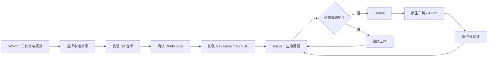

# 决策记录：首版 DevOps 工作控制台需求

Status: rejected — 六域 DevOps 首版门槛由[长期 Workspace 切片](../../implemented/feature/2026-11-08-workspace-capability-slice.md)取代，不再指导下一版本范围

## 问题

Locus 的首个应用场景是 DevOps 全生命周期，但目标不是再造一个 DevOps 平台，而是在 Git、Gitea、Actions、SSH/FRP、Agent 等现有工具之上提供统一工作控制台。

当前仓库只有宿主与 CLI 骨架、v0 原语假说和 Workspace Explorer 设想，没有产品能力，也没有可验收的需求边界。若先按 Core、插件、原语划分模块，容易得到抽象正确但无人使用的实现；若按九个管理页面并列建设，又会变成松散的后台。需要先把首版产品需求写成可验收的体验，再由真实链路决定原语与模块。

首版要回答的不是“该有哪些抽象”，而是：用户打开 Locus 后，能否知道有哪些项目、正在发生什么、哪里出现问题，并从任意环节进入工作，调用人、Agent 或原生工具推进任务，结束后保留成果与经验。

## 提案

### 产品定位

Locus 是现有工具之上的统一工作控制台：

- 统一入口：工作区、项目、共享设施、活动与问题集中呈现。
- 原生工具优先：Git、Gitea、Actions、SSH/FRP、Agent 仍拥有执行与事实权威，Locus 不复制它们的运行时。
- 从观察进入行动：每个状态都能落到具体原生工具、Agent 会话或人工操作，并保留结果与未解决事项。
- 产品域不等于代码包：首版按用户能力组织，不要求九个独立模块；Workspace 与 Project 可以合并呈现，避免重复入口。

### 首版能力域

| 产品能力 | 用户获得 | 首版功能 | 优先级 |
| --- | --- | --- | --- |
| Workspace | 进入并管理工作环境 | 发现、注册、切换、关联目录和资源 | P0 |
| Project | 掌握项目全貌 | 项目概览、关联仓库、环境、活动 | P0 |
| Connections | 统一使用已有基础设施 | Git、Gitea、SSH、FRP 连接及状态 | P0 |
| Lifecycle | 看清 DevOps 全过程 | Commit → CI → 部署 → 运行验证 | P0 |
| Issues | 知道哪里需要处理 | CI 失败、连接异常、未知状态、诊断入口 | P0 |
| Agent / Actions | 从观察进入行动 | 启动或恢复 Agent、调用原生工具、查看反馈 | P0 |
| Activity | 离开后仍能接续工作 | 汇集 Git、CI、Agent 的活动及关联 | P1 |
| Knowledge | 积累可复用成果 | 文档、决策、经验、Skill 关联 | P1 |
| Automation | 减少重复操作 | 事件监听、自动检查、通知、触发任务 | P1 |

P0 六域共同支撑第一条真实链路；P1 不阻塞首版，但首版的数据与导航不能封死其扩展。首版不追求九个域各自完整，而是先让六个 P0 域在同一条链路上互相支撑。

### 体验层次

| 层次 | 回答的问题 | 首版形态 |
| --- | --- | --- |
| World | 我有哪些工作环境，哪里需要注意 | 全局控制台：工作区、项目、共享设施、最近活动、待处理问题 |
| Focus | 这个项目正在发生什么，我能做什么 | 工作现场：生命周期、关联资源、历史、知识、Agent 与可执行操作 |
| Ambient | 我没打开时发生了什么 | 刷新、轮询、事件记录与未解决事项汇总；不建完整后台自动化 |

World 与 Focus 是产品结构，不是首版必须交付的 Web 页面。首版通过 CLI 命令与人类/JSON 输出体现这两个层次；Web 后续复用同一领域能力，只替换交互层。Ambient 先以按需刷新和事件记录实现，避免在观察机制尚未验证时引入常驻调度系统。

### 交付顺序

首版只交付 CLI，Web 界面后置。CLI 与后续 Web 共用领域能力；CLI 先验证需求、数据与操作，Web 只替换交互层。

实现顺序固定为：功能需求 → CLI 命令与输出 → 领域能力/模块 → core 基础原语。先由命令面暴露真实用法，公共能力在复用点形成；不为九个产品域预建九个包。CLI 分层与领域命令设计见[CLI 优先与领域模块](../architecture/2026-11-06-cli-first-domain-modules.md)。

### 采购与自建边界

| 能力 | 优先复用 | Locus 负责 |
| --- | --- | --- |
| 工作区与文件 | Node.js、原生文件系统 | 工作区管理和多来源关联 |
| 仓库与代码 | Git CLI | 项目关联、状态视图 |
| CI/CD | Gitea Actions | 流水线关联、异常诊断 |
| 远程连接 | OpenSSH、现有 FRP | 连接配置、可达性与工作关联 |
| Agent | OMP、ACP 兼容工具 | 工作情境、会话关联、交接 |
| 数据集成 | 借鉴 Backstage 的 Provider / Processor 模式 | 轻量发现、观察和状态组合 |
| 持久化 | SQLite、JSON、Markdown | Locus 自有的声明、关系和历史 |
| UI | React、Ant Design、DSH client UI | 统一交互与产品体验；首版不实现 Web |

不整体引入 Backstage；OpenHands/ACP 可作为现成工作台参考，但不成为必需依赖。Locus 不自建 CI、SSH、FRP 或 Agent 执行运行时。

### 第一条真实链路

1. 接入项目：选择本地目录，发现 Git 仓库，确认 Workspace。
2. 关联设施：识别 Git Remote，连接现有 Gitea，关联 CI 与部署机器。
3. 呈现状态：看到最近提交、流水线结果、部署验证情况。
4. 发现问题：CI 失败或部署状态未知时进入 Issues。
5. 推动工作：打开原生工具或交给 Agent 调查，执行并验证。
6. 持续工作：退出再进入，保留关联、重要判断与未解决事项。

完成这条链路，才算最小但真实的 DevOps 工作控制台；只做资源导航器不算完成。实现上允许先交付只读纵向切片（步骤 1–4），再接行动闭环（步骤 5–6），但首版验收以完整链路为准。

### 首版不做

- 不完整复制 Backstage、GitHub 或 Gitea 的目录、权限与级联删除语义。
- 不自建 CI/CD、SSH、FRP、Agent 运行时，也不要求所有操作经过 Locus。
- 不先建九套独立产品模块或九个代码包。
- 首版不实现 Web 界面；Web 在 CLI 验证领域能力后接入，复用同一服务，不复制业务逻辑。
- 不在首版实现完整 Activity、Knowledge、Automation；只保留可扩展的关联与入口。
- 不冻结 Workspace/Target/Observer/Identity 的完整数据模型；先实现链路所需的最小字段。
- 不把 DevOps 字段设为所有工作区的必需项；保留本地知识工作区与无目录基础设施工作区作为反例。

### 待决

| 事项 | 冲突或缺口 | 决策时点 |
| --- | --- | --- |
| 验收环境 | 需要真实项目、Gitea 实例、Actions 流水线与可连 SSH/FRP 目标；否则只能验证“未知状态”，不能验证真实失败与部署。 | 实现第一条链路前 |
| CLI 命令面与领域边界 | 领域命名空间、命令动词、JSON 输出与共享能力边界尚未定稿；本提案只给出产品域。 | CLI 设计评审时 |
| Workspace 与 Project 的呈现 | 产品域允许合并入口，但尚未决定 World 中如何分组、Focus 以哪个对象为上下文。 | 信息架构设计时 |
| Agent 接入方式 | OMP 与 ACP 兼容工具的具体调用、会话恢复与权限边界未定。 | 行动闭环前 |
| 持久化载体 | SQLite、JSON、Markdown 的分工未定；首版只能用带版本标记的实验格式。 | 首次持久化前 |
| Web 交付与认证 | Web 后置；若允许远程访问，认证与授权不在本提案范围内，需要单独决策。 | Web 开工前 |

## 备选方案

**直接建设完整 DevOps 平台。** 统一体验最强，但会与 Git、Gitea、Actions、SSH/FRP 争夺事实所有权，首版成本与维护面都不可控。不采用。

**按九个产品域分别建模块和页面。** 结构看似整齐，但用户需要在页面间搬运上下文，且首版无法同时做深九个域。不采用；保留九域作为能力清单，首版只贯通六个 P0。

**先实现完整 Core 原语，再做产品。** 能在早期统一抽象，但当前没有跨功能证据，容易把未验证的 Identity、Observer、Ingestion 固化成负担。不采用；由第一条真实链路倒推。

**只做 Workspace Explorer。** 能快速得到资源导航，但用户仍无法看到项目状态、发现问题或从观察进入行动，不能验证 Locus 的核心价值。不采用；Workspace 作为 World 的一部分，必须服务于完整链路。

**整体集成 Backstage。** 可复用目录与插件生态，但会引入其所有权、权限与级联删除模型，偏离本地优先和原生系统自治。不采用；只借鉴 Provider / Processor / Stitching 的处理方式。

**自建 CI、SSH、FRP 或 Agent 运行时。** 能完全控制体验，但重复成熟工具且扩大首版边界。不采用；只做配置、关联、状态与交接。

**首版同时完成九个能力域。** 覆盖最全，但无法在首版内形成可靠闭环。不采用；P1 保留为后续能力。

## 验收标准

- 用项目内 DSH 运行 CLI，能列出工作区、项目与待处理问题；空数据时有明确空状态，不伪造内容。
- 选择一个真实本地目录后能发现 Git 仓库，并由用户通过显式确认命令注册；未确认的候选不会自动持久化。
- 已确认的工作区能关联 Git Remote、Gitea、CI 与至少一个远程目标；连接失败或未知时输出来源与明确状态，不静默当成成功。
- 项目与生命周期命令能显示最近提交、CI 结果与部署验证状态；缺失或过期的数据标为未知，不用旧值冒充当前值。
- CI 失败、部署未知或连接不可达能在 Issues 命令中出现，并能进入对应原生工具或诊断入口。
- 能从 CLI 启动或恢复一个携带工作区/项目上下文的 Agent 会话，或打开原生工具；执行结果与验证结论回到项目记录。
- 退出并重新启动 CLI 后，工作区、关联、未解决事项与重要判断仍可恢复；复制实验数据到另一环境后也能恢复入口。
- 一个不含 Git 的本地目录可以注册为工作区，输出“无关联项目/仓库”，而不是报错或伪造仓库。
- 关键查询命令提供可解析的 JSON 输出，人类输出不混入日志或 ANSI 噪声；用法错误与运行失败返回明确非零退出码。
- 现有 CLI 与宿主链路不回归：`DSH_HOME=.dsh pnpm exec dsh --profile locus version` 仍输出 `0.0.0`。

## 风险

- **范围过大。** 六个 P0 域、CLI 命令面和 Agent 接入同时推进，容易做成横向半成品。必须以六步链路为纵向切片，先只读后行动。
- **外部系统不可用。** Gitea、Actions、SSH/FRP 的凭据、网络与权限差异会让验收停在“未知”。需要先准备真实环境，并把不可用作为一等状态，而不是用样例数据绕过。
- **CLI 输出变成隐形契约。** 人类文本或临时 JSON 字段被脚本和后续 Web 依赖后，领域能力会被终端展示绑死。共享能力必须返回与展示无关的数据，JSON 输出单独定义。
- **CLI 逻辑膨胀。** 命令处理里直接写 Git/Gitea/SSH、持久化或业务规则，会阻断 Web 复用并制造第二套实现。CLI 只做参数、编排、展示与退出。
- **Agent 接入不稳定。** OMP/ACP 的会话、权限与恢复语义尚未验证；首版只做最小上下文与交接，不把 Agent 能力当成基础设施。
- **数据模型过早固化。** 为 CLI 输出方便而扩字段，可能把 DevOps 假设写进所有工作区。实验格式必须带版本与迁移/清除路径。
- **变成另一个孤岛。** 如果 Locus 只展示状态、不能深链回原生工具或执行操作，用户仍要在多个系统间搬运上下文。
- **反例被忽略。** 只按 DevOps 建模会让本地知识工作区和无目录基础设施工作区无法表达；首版至少保证注册路径不拒绝它们。
- **CLI 泄露敏感信息。** 连接配置、令牌或远程命令输出可能进入终端与日志；输出与错误信息必须默认脱敏。
