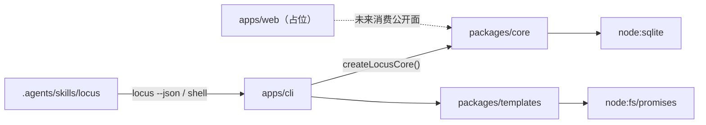

# 项目架构

改动 `packages/` 或 `apps/` 前先读本文。本文维护当前组件、依赖与扩展边界；决定理由在 Agent Notes，用法在模块 README，验证入口在[测试系统](testing.md#分层与入口)。

## 当前交付与方向

当前交付 Workspace：具有持久 UUID 的工作语境、`member` / `association` 两类显式长期关系、多个本机目录挂载、注入 Workspace 上下文的统一 shell，以及独立的本机项目模板复制。Workspace 可以没有目录，关系目标是领域解释的 `namespace` / `id` 不透明引用；挂载只保存绝对路径与名称，不检查目录是否存在。挂载与 shell 的取舍见 [Workspace 挂载与统一 Shell](../.agents/notes/implemented/feature/2026-11-13-workspace-mounts-and-shell.md)，模板设计见[项目模板子系统](subsystems/project-templates.md)，模板取舍见 [项目模板](../.agents/notes/implemented/feature/2026-11-13-project-templates.md)。

仓库采用 packages + apps 结构，不采用宿主插件模式。`packages/core` 是唯一领域内核与公开面，`apps/cli` 是独立可执行程序，`apps/web` 仅保留占位，`.agents/skills/locus` 是 Agent 使用 CLI 的分层 Skill。没有 DSH/Cordis 依赖、profile 装配、插件加载器、Operation Catalog 或能力注册表；回退理由与保留语义见 [packages/apps 决定](../.agents/notes/implemented/architecture/2026-11-13-packages-apps-workspace-core.md)。

## 组件与依赖

| 路径 | 当前职责 |
| --- | --- |
| `packages/core/` | Workspace 身份、长期成员/关联、来源、SQLite 持久化与公开服务；无 HTTP、CLI 或宿主依赖 |
| `apps/cli/` | 独立 `locus` bin：参数解析、调用 Core、人类/JSON 渲染、统一 shell 与退出码；不重新实现领域规则 |
| `apps/web/` | 占位，无可运行入口；等真实接口消费需求再实现 |
| `packages/templates/` | 复制模板文件夹、计算 digest、写实例 `.template.json`；只依赖 Node 文件系统，不接触 Core |
| `.agents/skills/locus/` | 分层索引、Workspace/Shell 参考与只读脚本；通过 CLI JSON 契约工作，不直接访问数据库 |

下图表示编译期依赖；CLI 通过 `createLocusCore()` 使用 Core，Core 不反向依赖任何 app。

编译依赖：Core 与 Templates 只依赖 Node 内置模块；CLI 依赖 Core、Templates 与 Commander。没有共享 contracts 包：Workspace 类型随 Core 的公开入口导出，等出现第二个真实消费端时再抽取同构契约。

## 边界

- `createLocusCore()` 是唯一装配入口；服务集合、延迟打开与释放语义由 [Core](../packages/core/README.md)维护。
- CLI 只拥有参数、确认、渲染、shell 与退出码。创建、改名、关系与挂载写入全部调用 Core；不存在隐式当前 Workspace 或第二套持久化。
- `locus shell` 由 CLI 拥有：注入 Workspace 上下文、不修改 shell profile、不是权限沙箱；注入清单见 [CLI](../apps/cli/README.md#统一-shell)。
- `.agents/skills/locus` 只通过 CLI 的 JSON 输出与 `shell --print-env` 读取事实，不复制领域规则或直接写 SQLite。
- `packages/templates` 只复制文件与写实例 `.template.json`，不创建 Workspace、不挂载目录、不执行模板脚本；模板源可以是内置 ID 或本地目录。
- 不预建插件加载、动态注册、Provider 仲裁或通用能力抽象。新增能力时建立普通 package，在 Core 或 app 的组合根显式接入；需要修改代码与构建，这是刻意选择。
- Web 当前没有服务器、路由或前端依赖。首个实现应复用 Core 的公开面，并在浏览器需要 DTO 时再抽取同构契约，不提前建立空框架。
- 领域观察与长期关系分离。外部事实由所属能力按需读取，只有用户显式确认后才写入 Workspace 关系。

## 数据与恢复

Core 独占 `dataDirectory/core.sqlite`，是 Workspace、挂载与关系的唯一写入所有者。数据目录位置、格式版本与迁移、事务与锁参数、备份与损坏恢复由 [Core](../packages/core/README.md#持久化与恢复)维护。

## 控制与演进

构建与运行事实由[开发与验证](development.md)维护；Core API、持久化与限制由 [Core](../packages/core/README.md)维护；命令语法由[命令手册](commands.md)维护。长期取舍由 Agent Notes 承载，控制面只服务临时任务。

只有实际交付且验证的行为进入 implemented。新增能力按具体应用逐个重配；出现第二个消费端或真实领域闭环时才增加 package，不恢复通用插件运行时。
