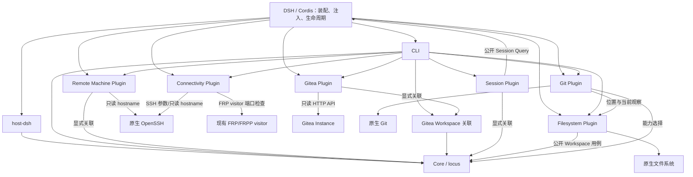

# 项目架构

改动 `packages/` 下内容前先读本文。本文维护当前组件、依赖与扩展边界；决定理由在 Agent Notes，用法在模块 README，验证入口在[测试系统](testing.md#分层与入口)。

## 当前交付与方向

Workspace Foundation 已交付：独立于目录/Project/Session 的长期 Workspace，持久身份与显式成员/关联；Filesystem 的多位置登记、按需发现与读取；Git 通过 Filesystem 线索进行最小只读观察；Session 只读发现、显式关联与原生返回入口；Remote Machine 的稳定机器身份、多地址、Workspace 共享关联与单地址 SSH 只读观察；Connectivity 的 SSH Connection Profile、配置检查、真实连接验证与原生入口；Gitea 的实例、来源限定仓库引用、Actions Run 与 Workspace 关联观察。CLI 在项目内 DSH profile 提供完整用户入口，重启、能力缺失和资源消失不删除长期关系。

[Workspace 产品决定](../.agents/notes/implemented/feature/2026-11-08-workspace-capability-slice.md)、[Session 集成决定](../.agents/notes/implemented/feature/2026-11-09-session-integration.md)、[Remote Machine 决定](../.agents/notes/implemented/feature/2026-11-09-remote-machine.md)、[Connectivity 决定](../.agents/notes/implemented/feature/2026-11-09-connectivity.md)、[Gitea 决定](../.agents/notes/implemented/feature/2026-11-09-gitea.md)维护已交付概念与范围，[组件与恢复决定](../.agents/notes/implemented/architecture/2026-11-08-workspace-capability-composition.md)维护所有权与取舍。完整 DevOps、自动部署、Blueprint 执行、多提供方和跨设备能力仍在[提案](../.agents/notes/proposed/feature/2026-11-08-workspace-capability-evolution.md)，不等于已有实现。

## 组件与依赖

| 路径 | 当前职责 |
| --- | --- |
| `packages/contracts/` | 当前真实生产者/消费者共享的最小类型；无 DSH/Cordis 或运行逻辑 |
| `packages/core/` | Workspace 身份、长期成员/关联、必要来源与能力选择快照；自有持久数据，不解释领域引用 |
| `packages/host-dsh/` | 创建/持有 Core，提供 `locus` 公开用例并随 fiber 释放 |
| `plugins/filesystem/` | 位置登记与本机引用、范围、原生状态、单层发现和有界读取；自有配置 |
| `plugins/git/` | 消费 Filesystem 局部协议，原生 Git 只读查询；不维护第二套成员或位置模型 |
| `plugins/session/` | 消费 DSH `sessionQuery`，只读发现与检查 Session；不复制消息历史或执行状态 |
| `plugins/remote-machine/` | 机器管理身份、多地址、Workspace 共享引用与单地址 OpenSSH 只读观察；不拥有连接或远端生命周期 |
| `plugins/connectivity/` | 机器级 Connection Profile、OpenSSH 配置检查、真实连接验证与原生命令入口；不拥有 SSH/FRP 运行时 |
| `plugins/gitea/` | Gitea 实例配置、来源限定仓库引用、Actions Run 只读观察与凭据引用；不拥有 Gitea 事实或 CI 生命周期 |
| `plugins/cli/` | 参数/帮助、用例编排、显式确认、人类/JSON 渲染与退出；不实现领域 I/O |
| `tests/`、`scripts/` | 隔离真实资源测试及实际 profile 验收，不成为业务运行依赖 |

下图表示运行时调用/装配，类型依赖统一经 contracts；不表示所有能力都要由 Core 转发。

编译依赖：Core 仅 Node 与 contracts；host 依赖 Core/contracts 和 Cordis 类型；功能/应用 Plugin 依赖所用 contracts 与实际 DSH 包，不反向让 Core import Plugin。CLI 不依赖 Core 或领域 Plugin 实现包；非 CLI 调用使用实际库入口，不创建独立 Host。Session 的 `ctx.sessionQuery` 由 DSH 提供，Locus 只消费公开服务；Remote Machine 直接调用原生 OpenSSH，不读取或修改 SSH 配置；Connectivity 只保存配置引用并调用 OpenSSH，不启动 SSH/FRP 运行时；Gitea 只通过 HTTP API 读取实例、仓库与 Run，不复制 CI 历史或部署运行时。

## 宿主与扩展边界

- 当前只支持项目内 DSH/Cordis，不预建 Host 抽象、专用 Host、独立 HTTP/启动器、中央插件总线或第二运行时。
- CLI 的 `shell` 只是同一 CLI 插件内的长驻命令循环，复用现有命令树、领域服务和持久化；开发期 HMR 仍由 DSH/Cordis 管模块与 fiber，不新增运行时或插件管理器。
- Core/contracts 暂无 DSH/Cordis 依赖；功能与应用 Plugin 可直接使用 DSH 服务，host 不提供服务镜像或通用注册器。
- `locus` 由 host 唯一提供；领域 Plugin 直接提供当前需要的服务，随 fiber 撤销，不占用无关 DSH 顶层名字。Session 使用 `locusSession`，不复制 `ctx.sessionQuery` 或 DSH Session 运行时；Remote Machine 使用 `locusRemoteMachine`，不复制 OpenSSH 或连接管理；Connectivity 使用 `locusConnectivity`，只组合 Remote Machine 公开用例与 OpenSSH；Gitea 使用 `locusGitea`，可选消费 DSH `credentials`，不复制 Gitea 或 DSH 凭据存储。
- Capability 与 Plugin 不一一对应；当前声明与保存的提供方选择分开，Tag 只分类。多提供方自动仲裁未实施。
- CLI 不是模型的来源；后续 Web 调用同一领域用例，不解析 CLI 输出或复制规则。候选能力不按清单预建包。

## 技术与数据

| 范围 | 当前选择与限制 |
| --- | --- |
| 工程 | TypeScript、Node.js、ESM、pnpm Workspace；实际环境与命令见[开发与验证](development.md) |
| 宿主 | 项目内 DSH `0.2.1-rc.5` + Cordis，既有 `locus` profile，`link:` + patch |
| 持久化 | 内置 SQLite：Core、Filesystem、Remote Machine、Connectivity 与 Gitea 各自独立库，实验版本 1；不规定后续 Plugin 的最终载体 |
| 领域读取 | Node 文件系统、无 shell 的原生 Git、只读 OpenSSH `hostname`、OpenSSH `-G`、FRP visitor 本地端口探测与 Gitea 只读 HTTP API；不取代外部事实权威，不自动复制或删除资源 |
| 验证 | 内置 Node 测试 + 真实 DSH profile；不引入额外业务测试框架或用文档检查代替业务证据 |
| Web | 未实施；既有 React/TypeScript/Vite/Ant Design、优先复用 DSH UI/通信的方向未改变 |

数据所有权与物理位置独立。Core 保存长期身份、确认关系与不透明引用，Plugin 解释领域规则；外部对象不可达不等于关系不存在。Session 的消息、执行状态和标题仍由 DSH 拥有；Remote Machine 的机器资料与地址归该 Plugin；Connectivity 的 Profile 归该 Plugin，SSH 配置、凭据和 FRP/FRPP 隧道生命周期仍归 OpenSSH/用户/外部面板；Gitea 的实例配置归该 Plugin，仓库、Run、日志、Artifact、Secret、权限与凭据值仍归 Gitea/DSH credentials/用户。Core 只保存 Workspace 关联与来源命名空间。备份在停止全部写者后复制整个数据目录，原生资源和授权不隐含包含；版本、恢复与清除约定见 [Core](../packages/core/README.md#持久化与恢复)，当前模型不承诺在线多库快照或多设备同步。

## 控制与演进

[Workspace Capabilities CP](../.cp/cp-2026-11-09-workspace-capabilities.md)维护 Workspace 产品语义、能力组合与功能演进；[Core Primitives CP](../.cp/cp-2026-11-06-core-primitives.md)维护 Core 长期事实与持久化边界；[Host-DSH CP](../.cp/cp-2026-11-08-host-dsh.md)维护装配/服务面回归；[Bootstrap CP](../.cp/cp-2026-11-06-bootstrap.md)维护构建及运行时约束。控制面不代替源码或模块用法。

只有实际交付且验证的行为进入 implemented；未交付方向遵循 [Agent Notes 生命周期](../.agents/notes/AGENTS.md#在生命周期之间移动)。防御集中于实际输入与故障边界，不为假想异常增加重复校验、静默回退或通用抽象。
