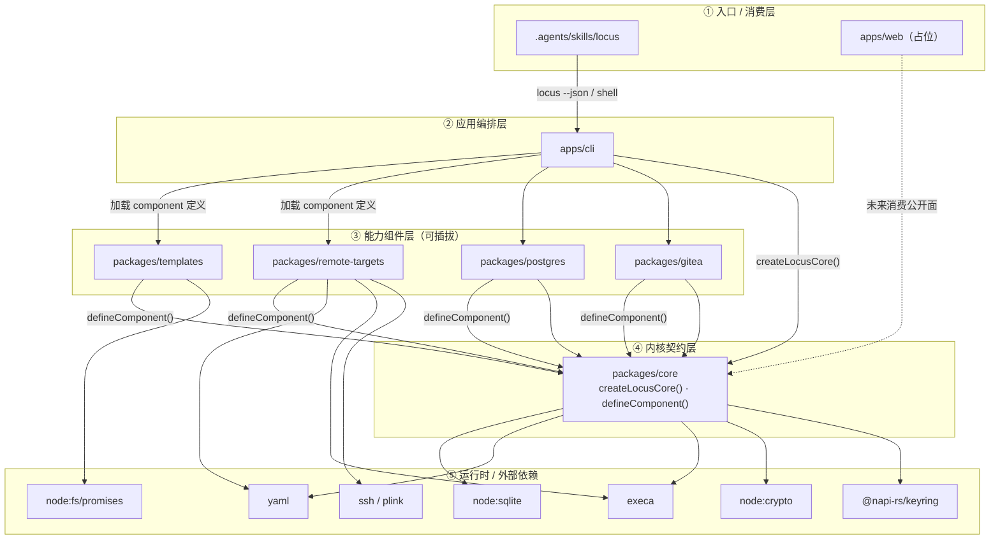

# 项目架构

改动 `packages/` 或 `apps/` 前先读本文。本文维护当前组件、依赖与扩展边界；决定理由在 Agent Notes，用法在模块 README，验证入口在[测试系统](testing.md#分层与入口)。

## 当前交付与方向

当前交付 Workspace 与 Component：Workspace 具有持久 UUID 的工作语境、`member` / `association` 两类显式长期关系、多个本机目录挂载、注入 Workspace 上下文的统一 shell 与独立的本机项目模板复制；Component 机制登记包组件与动态外部组件，保存定义、版本与外部/部署状态，并提供 `probe`、`deploy`、`upgrade` 与 `locus <id>` 入口。Core 同时是统一的权限真源与凭据保管平面：Compose 用一份 `defineComponent` 声明 operation 表与凭据 slot，Root 按 `component:operation` 覆盖认证等级，User 通过已授权 operation 消费字段。远程 SSH 目标通过 `component + slot + resourceKey` 绑定接入同一平面。

Workspace 可以没有目录，关系目标是领域解释的 `namespace` / `id` 不透明引用；挂载只保存绝对路径与名称，不检查目录是否存在。组件定义可复制、可手工编辑，状态只在本机观察。挂载与 shell 的取舍见 [Workspace 挂载与统一 Shell](../.agents/notes/implemented/feature/2026-11-13-workspace-mounts-and-shell.md)，模板设计见[项目模板子系统](subsystems/templates.md)，远程目标边界见[远程目标子系统](subsystems/remote-targets.md)，组件语义见[组件子系统](subsystems/core/components.md)，调用协议见[统一资源调用](subsystems/invocation.md)。

仓库采用 packages + apps，不采用宿主插件模式。Core 包含 Workspace、组件、operation 路由与统一安全平面；CLI 是独立程序及可信本地认证 Host，Web 仍占位。没有 DSH/Cordis、插件 profile 装配或动态命令生成；安全 Profile 仅隔离本地数据与凭据命名空间，operation 声明与 Root 覆盖不是通用 Policy 引擎。安全边界见 [Core Security](subsystems/core/security.md)，组件取舍见[组件模型](../.agents/notes/implemented/architecture/2026-11-15-component-model.md)。

## 组件与依赖

| 路径 | 当前职责 |
|---|---|
| `packages/core/` | Workspace、组件、operation 路由与 Dispatcher、统一权限平面、凭据保管、绑定、Grant、事件与 SQLite 元数据；不依赖 HTTP、CLI 或具体业务消费者 |
| `packages/postgres/` | 临时 PostgreSQL 验证消费者：声明 `pg.database.register` / `pg.database.query` 与 `database-auth` 字段槽；不是长期产品包，验证完成后移除 |
| `packages/gitea/` | Gitea Compose：声明 `gitea.repository.register` / `gitea.repository.request` 与 `api-token` 字段槽，用绑定 origin 的 Authorization Header 发起请求 |
| `apps/cli/` | 独立 `locus` bin：参数解析、经 Dispatcher 调用 operation、人类/JSON 渲染、统一 shell 与退出码；不重新实现领域规则 |
| `apps/web/` | 占位，无可运行入口；等真实接口消费需求再实现 |
| `packages/templates/` | 复制模板文件夹、计算 digest、写实例 `.template.json`；导出 `locus` 组件的 `component` 与 `operations` |
| `packages/remote-targets/` | 声明式登记 SSH 目标、校验身份/能力/连接、通过 `OperationContext.credential` 获取受限临时凭据并调用系统 OpenSSH/Plink；导出 `locus` 组件的 `component` 与 `operations`，消费 `openssh`/`plink` 状态 |
| `.agents/skills/locus/` | 分层索引、Workspace/组件/远程目标参考与只读脚本；通过 CLI JSON 契约工作，不直接访问数据库 |

下图表示编译期依赖与组件定义流向；CLI 通过 `createLocusCore()` 使用 Core，Core 不反向依赖任何 app 或包。

Core 使用 Node、yaml、组件 runner 的 execa，并懒加载 Keyring；PostgreSQL 与 Gitea 各自依赖 Core，PostgreSQL 运行时使用 `pg`。Remote Targets 依赖 Core、yaml、execa 与 node:sqlite。CLI 显式组合各包和 Commander；Core 不反向依赖任何消费者。

## 边界

- `createLocusCore()` 是唯一装配入口；服务集合、延迟打开、组件定义注入与释放语义由 [Core](../packages/core/README.md)维护。
- `packages/` 下除 Core 外的每个包都必须导出经 `defineComponent()` 校验的 `component`，`kind` 为 `locus`，id 唯一；由 CLI 组合根显式传入 Core。`tests/components.test.mjs` 检查这条契约。
- CLI 拥有参数、确认、渲染、shell、可信认证输入与退出码；领域写入和授权调用所属服务，不存在隐式当前 Workspace 或第二套持久化。
- `locus shell` 由 CLI 拥有：注入 Workspace 上下文、不修改 shell profile、不是权限沙箱；注入清单见 [CLI](../apps/cli/README.md#统一-shell)。
- 组件定义是数据文件或代码常量，不是可执行插件。Core 不加载模块、不执行生命周期回调；动态组件只接受 `kind: external`，包组件只接受 `kind: locus`。组件包不得包含 CLI 命令、参数、提示、退出码或 `locus ...` 用法文本；`component.info` 只描述组件用途与 operation 入口。
- 包组件首次访问时物化到 `<dataDirectory>/components/<id>.yaml`，版本不一致只标记“需要升级”，`component upgrade` 才重写定义字段并保留 `config`；包组件不可删除。
- Compose 用 `defineComponent` 声明 operation 与凭据字段；声明不授予权限。Root 通过组件 operation（如 `pg register`）写入字段并建立 `component + slot + resourceKey` 绑定，普通 User 只能消费已绑定且 operation 获准的路径。
- `locus <id>` 只解析未知顶层命令，不进入 `--help`；帮助与版本不访问组件服务，不创建数据目录。
- `packages/templates` 只复制文件与写实例 `.template.json`，不创建 Workspace、不挂载目录、不执行模板脚本。
- Remote Targets 以 targets.yaml 为真源、state.sqlite 为观察状态，消费 CLI 注入的组件状态窄视图 `ComponentGate` 与 `OperationContext.credential`。新配置使用 `method: private-key|password`，凭据按 `component + slot + target id` 绑定；旧文件只供 `remote-targets migrate` 显式导入，运行时不再读取旧秘密文件。带口令私钥迁移明确阻塞，不自动去口令。
- 传输组件检查在连接前完成，但不替代目标能力与凭据检查；未登记或状态未就绪时明确失败，不静默改用其他客户端。Plink 密码仍使用受限临时文件，密码不进入 argv、环境变量或普通配置。
- 不预建插件加载、Provider 仲裁或组件依赖图。Core 自有领域扩展公开服务，独立消费者建立普通 package、导出组件定义与 operation 并在组合根接入；固定安全规则不扩张为任意可编辑策略。
- Web 当前没有服务器、路由或前端依赖。首个实现应复用 Core 的公开面，并在浏览器需要 DTO 时再抽取同构契约，不提前建立空框架。
- 领域观察与长期关系分离。外部事实由所属能力按需读取，只有用户显式确认后才写入 Workspace 关系。

## 源码组织

包内按领域聚合，领域内部区分公开契约、operation、服务与外部适配器，不建立横向的 contracts/runtime/shared 包。Core 根入口只负责运行时创建，领域能力通过显式公开子路径消费；包内依赖具体实现文件，不经公开 barrel。各包自己维护领域错误到协议错误的转换，operation 返回可序列化 DTO，原生客户端对象留在适配器内。

修改场景到源码与测试的导航由模块 README 维护：[Core](../packages/core/README.md#源码导航)、[CLI](../apps/cli/README.md#源码导航)、[Remote Targets](../packages/remote-targets/README.md#源码导航)、[Templates](../packages/templates/README.md#源码导航)、[Gitea](../packages/gitea/README.md#源码导航)、[临时 PostgreSQL 消费者](../packages/postgres/README.md#源码导航)。不维护手抄符号总表或完整文件树。取舍见[源码所有权与导航边界](../.agents/notes/implemented/architecture/2026-11-18-source-ownership-and-navigation.md)。

## 数据与恢复

Core 独占 core.sqlite（当前 schema v8），保存 Workspace、组件状态、operation 等级覆盖、凭据公开字段与 owner、凭据引用元数据、`component + slot + resourceKey` 绑定与事件记录；资源秘密在 OS Keyring，Root 派生验证材料单独持久化。组件定义、Remote Targets 的 targets.yaml/state.sqlite 仍各有归属。开发阶段数据库不承诺旧 schema 兼容，结构变更按当前 schema 重建；停写备份由 [Core](../packages/core/README.md#持久化与恢复)维护，秘密和备份后果由[安全子系统](subsystems/core/security.md#持久化错误与备份)维护。

## 控制与演进

构建与运行事实由[开发与验证](development.md)维护；Core API、持久化与限制由 [Core](../packages/core/README.md)维护；组件字段、状态与失败边界由[组件子系统](subsystems/core/components.md)维护；远程目标的字段、失败与限制由 [Remote Targets](../packages/remote-targets/README.md)维护；命令语法由[命令手册](commands.md)维护。长期取舍由 Agent Notes 承载，控制面只服务临时任务。

只有实际交付且验证的行为进入 implemented。新增能力按具体应用逐个重配；出现第二个消费端或真实领域闭环时才增加 package，不恢复通用插件运行时。组件定义可以随包复制，但机器相关值与状态不承诺跨机自动迁移。
