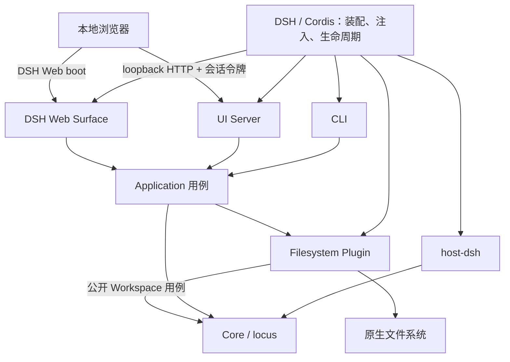

# 项目架构

改动 `packages/` 或 `plugins/` 下内容前先读本文。本文维护当前组件、依赖与扩展边界；决定理由在 Agent Notes，用法在模块 README，验证入口在[测试系统](testing.md#分层与入口)。

## 当前交付与方向

Workspace Foundation 已交付：独立于目录/Project/Session 的长期 Workspace，持久身份与显式成员/关联；Filesystem 的多位置登记、按需发现、有界读取与受控新建/重命名；该能力只保存位置配置，确认后的长期关系由 Core 保存。CLI 与本地 UI 通过同一 `@locus/application` 用例层操作这些能力，重启、能力缺失和资源消失不删除长期关系。DSH Web 原生表面（`locus-web` profile）把 Locus 作为 DSH 内的嵌入应用：左侧菜单与 Session header 入口打开绑定当前 Session 的真实 Conversation；页面保留 native 风格 header、Hash URL 与「会话/概览/文件/工作区 + DSH 视图」tab。工作区 tab 内联创建/改名、位置登记/移除与 DSH 工作区关联；它不是独立服务或外部页面。Host 端投影观察、支持上述写入，并把用户显式的 DSH 工作区关联写入 Core association；不创建资源成员，也不写其他领域关系。

当前范围是 Workspace 与 Filesystem 的第一版交互闭环，共享用例与 UI 形态见[交互面决定](../.agents/notes/implemented/feature/2026-11-12-workspace-filesystem-surfaces.md)；写入契约与 DSH 原生复用审计见[Filesystem v0 决定](../.agents/notes/implemented/feature/2026-11-12-filesystem-api-v0.md)。被移除的 Operation Catalog、Capability 选择、应用生成机制及未重配领域见[精简决定](../.agents/notes/implemented/simplification/2026-11-12-prune-plugin-machinery.md)；新增领域按具体应用需要接入，不预建通用能力生成、契约 DSL、中央注册表或第二套运行时。Mount、多 Provider 与 Execution World 仍是方向性概念，尚未进入实现。

## 组件与依赖

| 路径 | 当前职责 |
| --- | --- |
| `packages/contracts/` | 当前真实生产者/消费者共享的最小类型：Workspace、关系、Filesystem 局部协议与 UI 启动接口；无 DSH/Cordis 或运行逻辑 |
| `packages/application/` | CLI 与 UI 共用的 Workspace/Filesystem 用例；只组合公开服务，不拥有持久化或领域 I/O |
| `packages/core/` | Workspace 身份、长期成员/关联与必要来源；自有持久数据，不解释领域引用 |
| `packages/host-dsh/` | 创建/持有 Core，提供 `locus` 并随 fiber 释放 |
| `packages/dsh-surface/` | DSH Web 原生表面：Host `/locus/api` 观察投影、Workspace 创建/改名、位置配置写与工作区关联 + `dsh.client` 的独立 Locus Main Panel、原生 rightbar 补丁与 Workspace 管理；不拥有领域数据 |
| `plugins/filesystem/` | 位置登记与本机引用、范围、原生状态、单层发现、有界读取与受控新建/重命名；自有配置 |
| `packages/ui/` | 核心交互包：loopback HTTP、JSON API 与 React 页面；主题与控件摘抄自 DSH，不拥有领域语义或第二套持久化 |
| `packages/cli/` | 参数/帮助、用例调用、显式确认、人类/JSON 渲染与退出；不实现领域 I/O |
| `tests/`、`scripts/` | 隔离真实资源测试及实际 profile 验收，不成为业务运行依赖 |

下图表示运行时调用/装配，类型依赖统一经 contracts；不表示所有能力都要由 Core 转发。

编译依赖：Core 仅 Node 与 contracts；application 仅依赖 contracts；host 依赖 Core/contracts 和 Cordis 类型；CLI、UI 与 Filesystem 不依赖 Core 实现包。DSH 是当前唯一宿主，不预建 Host 抽象、专用 Host 或独立业务运行时。

## 宿主与扩展边界

- `locus` 由 host 唯一提供；领域 Plugin 直接提供当前需要的服务，随 fiber 撤销，不占用无关 DSH 顶层名字。
- Filesystem 使用 `locusFilesystem`，只消费公开 Workspace 用例；不复制 Core 的身份或关系模型。
- `locusUi` 由 UI Plugin 提供，只在显式 `ui` 命令下监听 loopback；它不是第二个领域运行时，不自动启动，也不接受非 loopback 地址。
- `@locus/dsh-surface` 是 dual-face 包：Host 半边依赖 `webServer`，注册 `/locus/api`（观察投影、Workspace 创建/改名、位置登记/取消与工作区关联，进程令牌保护）；browser 半边注册独立 Locus Main Panel、左侧菜单、Session header 入口与 Hash 路由，并复用 DSH 原生 rightbar/Document Preview。rightbar 需要 `scripts/patch-dsh-rightbar.mjs` 对 `ui-sidebar-right` 打两处门控补丁。它只在包含 `dsh-web-app` 的 profile 装载，CLI profile 中保持未激活。
- CLI 与 UI 只调用 `createWorkspaceApplication` 暴露的用例；确认、注册、发现、读取等业务组合不在两个交互面各写一遍。
- CLI 的 `shell` 只是同一 CLI 插件内的长驻命令循环，复用现有命令树、领域服务和持久化；开发期 HMR 仍由 DSH/Cordis 管理模块与 fiber。
- 领域服务可以在缺少 Plugin 时明确失败；已保存的长期关系与领域配置保留。
- 不预建 Capability 注册表、能力选择门禁、Operation Catalog、插件命令生成器或跨领域应用框架。新增领域按具体应用需要接入，直接使用 TypeScript 模块、Cordis 服务和交互面投影。

## DSH 应用边界

DSH 是应用宿主：Application Shell、全局导航、Agent Runtime/Session、插件生命周期、原生 Slots 与文件预览。Locus 是 Workspace 应用：Core 身份与关系、Filesystem、位置、长期事实与 Workspace 内部导航。两者只通过 `@locus/dsh-surface` 的 Host 投影与 browser 注册连接；Locus Core、Application 与 Filesystem 不 import DSH/Cordis。

Locus 保留独立 `main` 面板、`sidebar.panellist` 左侧入口、Session header 入口与 Hash 路由（实现见 [独立 Locus 页面与原生 Rightbar](../.agents/notes/implemented/architecture/2026-11-13-locus-native-header-entry.md)）。Header：`Locus` 标题 + `DSH` 返回 chip；tab 行为概览/文件/工作区。DSH 工作区关联作为 `dsh.workspace` 外部引用写入 Locus Core 的 association 关系；一个 DSH 工作区最多关联一个 Locus 工作区。关联建立时把 DSH 工作区的文件夹登记为 Locus 位置，因此可直接浏览同一目录；用户仍可登记其他位置。原生 rightbar 通过 `ui-sidebar-right` 的两处门控补丁在 `activePanelId === 'locus'` 时保持挂载；文件浏览与预览复用原生 guide、Files 与 Document Preview。补丁脚本固定在 `scripts/patch-dsh-rightbar.mjs`，升级 DSH 后需重新执行。

## 技术与数据

| 范围 | 当前选择与限制 |
| --- | --- |
| 工程 | TypeScript、Node.js、ESM、pnpm Workspace；实际环境与命令见[开发与验证](development.md) |
| 宿主 | 项目内 DSH `0.2.2-rc.1` + Cordis，既有 `locus` profile，`link:` + patch |
| 持久化 | 内置 SQLite：Core 与 Filesystem 各自独立库，实验版本 1；不规定后续领域的最终载体 |
| 领域读取 | Node 文件系统；观察结果不持久化，不取代外部事实权威 |
| Web | React 18 + Vite + TypeScript + CSS Modules + clsx；`web/src/dsh/theme` 与 `dsh/primitives` 摘抄自 DSH master（MIT，摘抄时为 `0.2.1-rc.5`，当前宿主 `0.2.2-rc.1` 未逐项重校），使用 `--dsw-*` token、DSH 圆角/发丝线规则与反馈组件（StateDot/Toast/Tooltip/RiskConfirmation）；由 `packages/ui` 在 loopback 提供，无独立 Web Server |
| 验证 | 内置 Node 测试 + 真实 DSH profile；不引入额外业务测试框架或用文档检查代替业务证据 |

数据所有权与物理位置独立。Core 保存长期身份、确认关系与不透明引用，Plugin 解释领域规则；外部对象不可达不等于关系不存在。备份在停止全部写者后复制整个数据目录，原生资源和授权不隐含包含；版本、恢复与清除约定见 [Core](../packages/core/README.md#持久化与恢复)与 [Filesystem](../plugins/filesystem/README.md#数据与生命周期)。UI 只读取当前服务结果，不缓存派生事实。

## 控制与演进

构建、Core 边界与装配的事实分别由[开发与验证](development.md)、[Core](../packages/core/README.md)与 [Host-DSH](../packages/host-dsh/README.md)维护；长期取舍由 Agent Notes 承载，控制面只服务临时任务，收尾后删除。

只有实际交付且验证的行为进入 implemented；未交付方向遵循 [Agent Notes 生命周期](../.agents/notes/AGENTS.md#在生命周期之间移动)。防御集中于实际输入与故障边界，不为假想异常增加重复校验、静默回退或通用抽象。
