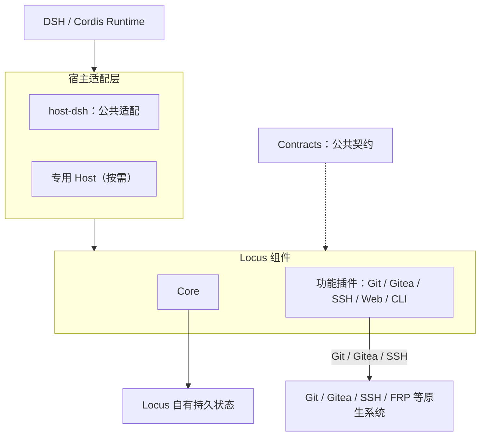

# 项目架构

改动 packages/ 下的任何内容之前，请先阅读本文。

## 组织

| 路径 | 计划职责 |
|---|---|
| `packages/contracts/` | 宿主无关的服务接口、组件协作协议、事件、数据结构及共享类型 |
| `packages/core/` | 独立 TypeScript 领域内核；工作空间基础能力、业务协调与自有持久状态 |
| `packages/host-dsh/` | DSH/Cordis 公共宿主适配；组件装配、依赖注入、服务暴露及生命周期衔接 |
| `plugins/` | Git、Gitea、SSH、Web、CLI 等功能插件；领域能力、原生系统集成与应用入口，有真实实现时再创建各插件包 |
| `scripts/` | 开发、构建、发布及维护辅助脚本 |
| `tests/` | 跨模块 E2E、关键业务流程与少量综合验证 |
| `docs/` | 设计、契约与参考 |

- **Contracts**：定义 Core、功能插件（含 Web、CLI）等组件之间的公共协议，包括服务接口、数据结构、事件及共享类型。不承担业务实现、插件装配或运行时管理，不依赖 DSH/Cordis。
- **Core**：独立 TypeScript Library，负责工作空间基础能力、业务协调及自有持久状态。不直接依赖具体宿主或功能插件，通过公共契约与其他组件协作。Core 自身也作为可装配组件接入宿主。
- **宿主适配层**：将独立组件接入 DSH/Cordis，复用现有插件装配、服务注入、事件通信和生命周期能力。`host-dsh` 提供公共适配，特定组件可按需提供专用 Host，不要求每个组件都有独立适配包，也不另建插件运行时。
- **功能插件**：Git、Gitea、SSH 等领域插件负责具体领域能力与原生系统集成；Web 与 CLI 作为应用插件实现，Web 优先复用 DSH 的 UI 与通信设施，CLI 提供命令行交互及必要的启动入口。插件通过公共契约描述对外能力和依赖，由宿主适配层接入 Cordis，允许插件间经宿主服务机制直接协作，而非强制经过 Core。各插件管理自己的业务配置，按需作为独立 npm 包发布。

**架构原则**：组件同构、宿主适配、契约共享、状态自治。Core 与各功能插件（含 Web、CLI）在逻辑上均为可装配组件；宿主负责运行时组织，Contracts 负责公共协议，不额外建立平行的插件运行时或中央服务总线。

**宿主独立性**：业务组件及公共契约原则上不依赖 DSH/Cordis，具体宿主能力封装于适配层。DSH 是首选运行宿主；未来如需迁移，可替换或新增宿主适配实现，而不要求重写所有业务组件。专用 Host 引入的宿主耦合应保持显式。

具体组件边界、服务契约、专用 Host 的必要性及持久化划分，仍需通过真实业务场景验证后确定。

## 技术选型

| 范围 | 已确定方向 |
|---|---|
| 语言与运行时 | TypeScript、Node.js 24/26、ESM |
| 项目组织 | pnpm Workspace、模块化单体 + 插件架构 |
| 宿主与插件 | DeepSeek Harness（DSH）+ Cordis；暂缓独立 Node Host，但不排除未来引入 |
| 公共契约 | 独立 TypeScript 契约包；定义服务接口、扩展契约与共享类型，不依赖 DSH/Cordis |
| 前端 | React、TypeScript、Vite、Ant Design |
| 服务与接口 | Cordis Services / Inject / Events、CLI、MCP / ACP；HTTP 与 Web 通信优先复用宿主能力，暂不引入独立 HTTP 框架 |
| 存储 | SQLite、JSON、原生文件系统、Git |
| 业务测试 | Vitest、Playwright |
| 扩展与分发 | TypeScript 插件、npm 版本化包、Locus Plugin SDK，复用现有 Agent Harness 与外部系统能力 |

## 持久化与原生系统

Locus 管理自身身份、关联、观察和长期工作状态，不依附于 DSH Session 或插件内存。通过 Node.js 能力及现有接口集成原生系统，保留外部系统的自治和事实所有权，不把观察副本当作外部真实状态的权威。

SQLite、JSON、文件系统和 Git 的具体分工尚未确定；不能从存储选型推导出 Manifest、数据表或迁移契约已经存在。

## 演进场景与未决边界

优先验证完整 DevOps 循环，以及跨工作空间共享资源：通过真实工作贯通本地项目、Git/Gitea、CI、SSH/FRP、部署观察和 Agent 行动，实测成本优化与自适应协调。它们是验证场景，不是已交付能力。

Workspace、Target、Observer、身份解析、多来源所有权、持久化划分、具体服务契约与插件故障处理仍需围绕场景确定。方案按 [Agent Notes 生命周期](../.agents/notes/AGENTS.md#在生命周期之间移动)维护：未实施或仅部分实施时保留提案，交付后按实际结果重写为已实施记录，不在当前架构页预造接口。
