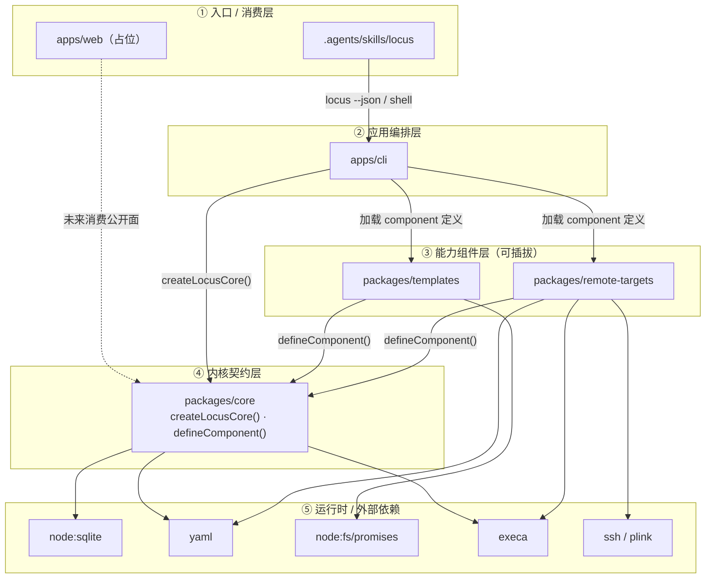

# 项目架构

改动 `packages/` 或 `apps/` 前先读本文。本文维护当前组件、依赖与扩展边界；决定理由在 Agent Notes，用法在模块 README，验证入口在[测试系统](testing.md#分层与入口)。

## 当前交付与方向

当前交付 Workspace 与 Component：Workspace 具有持久 UUID 的工作语境、`member` / `association` 两类显式长期关系、多个本机目录挂载、注入 Workspace 上下文的统一 shell 与独立的本机项目模板复制；Component 机制登记包组件与动态外部组件，保存定义、版本与外部/部署状态，并提供 `probe`、`deploy`、`upgrade` 与 `locus <id>` 入口。远程 SSH 目标仍是声明式登记、按需访问的接入面。

Workspace 可以没有目录，关系目标是领域解释的 `namespace` / `id` 不透明引用；挂载只保存绝对路径与名称，不检查目录是否存在。组件定义可复制、可手工编辑，状态只在本机观察。挂载与 shell 的取舍见 [Workspace 挂载与统一 Shell](../.agents/notes/implemented/feature/2026-11-13-workspace-mounts-and-shell.md)，模板设计见[项目模板子系统](subsystems/templates.md)，远程目标边界见[远程目标子系统](subsystems/remote-targets.md)，组件语义见[组件子系统](subsystems/components.md)。

仓库采用 packages + apps 结构，不采用宿主插件模式。`packages/core` 是唯一领域内核与公开面，包含 Workspace 与组件机制；`apps/cli` 是独立可执行程序，`apps/web` 仅保留占位，`.agents/skills/locus` 是 Agent 使用 CLI 的分层 Skill。组件以数据与代码常量登记，不加载插件模块、不执行生命周期回调；仍然没有 DSH/Cordis 依赖、profile 装配、Operation Catalog、能力级状态或动态命令生成。回退理由见 [packages/apps 决定](../.agents/notes/implemented/architecture/2026-11-13-packages-apps-workspace-core.md)，组件取舍见 [组件模型](../.agents/notes/implemented/architecture/2026-11-15-component-model.md)。

## 组件与依赖

| 路径 | 当前职责 |
|---|---|
| `packages/core/` | Workspace 身份、长期关系、挂载、组件定义契约与物化、组件状态、SQLite 持久化与公开服务；不依赖 HTTP、CLI 或宿主 |
| `apps/cli/` | 独立 `locus` bin：参数解析、调用 Core/Templates/Remote Targets、人类/JSON 渲染、统一 shell 与退出码；不重新实现领域规则 |
| `apps/web/` | 占位，无可运行入口；等真实接口消费需求再实现 |
| `packages/templates/` | 复制模板文件夹、计算 digest、写实例 `.template.json`；导出 `locus` 组件定义 |
| `packages/remote-targets/` | 声明式登记 SSH 目标、校验身份/能力/连接、调用系统 OpenSSH/Plink 执行；导出 `locus` 组件定义并消费 `openssh`/`plink` 状态 |
| `.agents/skills/locus/` | 分层索引、Workspace/组件/远程目标参考与只读脚本；通过 CLI JSON 契约工作，不直接访问数据库 |

下图表示编译期依赖与组件定义流向；CLI 通过 `createLocusCore()` 使用 Core，Core 不反向依赖任何 app 或包。

编译依赖：Core 依赖 Node 内置模块、`yaml`（读写组件定义）与 `execa`（执行探针与部署）；Templates 依赖 Core 的 `defineComponent()` 与定义类型；Remote Targets 额外依赖 YAML 解析库、`execa` 与 Core 的定义入口，并沿用 `node:sqlite`；CLI 依赖 Core、Remote Targets、Templates 与 Commander。`execa` 与 `yaml` 的版本由 pnpm catalog 统一。没有共享 contracts 包：Workspace 与组件类型随 Core 的公开入口导出，等出现第二个真实消费端时再抽取同构契约。

## 边界

- `createLocusCore()` 是唯一装配入口；服务集合、延迟打开、组件定义注入与释放语义由 [Core](../packages/core/README.md)维护。
- `packages/` 下除 Core 外的每个包都必须导出经 `defineComponent()` 校验的 `component`，`kind` 为 `locus`，id 唯一；由 CLI 组合根显式传入 Core。`tests/components.test.mjs` 检查这条契约。
- CLI 只拥有参数、确认、渲染、shell 与退出码。Workspace、组件与远程目标的写入全部调用对应服务；不存在隐式当前 Workspace 或第二套持久化。
- `locus shell` 由 CLI 拥有：注入 Workspace 上下文、不修改 shell profile、不是权限沙箱；注入清单见 [CLI](../apps/cli/README.md#统一-shell)。
- 组件定义是数据文件或代码常量，不是可执行插件。Core 不加载模块、不执行生命周期回调；动态组件只接受 `kind: external`，包组件只接受 `kind: locus`。
- 包组件首次访问时物化到 `<dataDirectory>/components/<id>.yaml`，版本不一致只标记“需要升级”，`component upgrade` 才重写定义字段并保留 `config`；包组件不可删除。
- `locus <id>` 只解析未知顶层命令，不进入 `--help`；帮助与版本不访问组件服务，不创建数据目录。
- `packages/templates` 只复制文件与写实例 `.template.json`，不创建 Workspace、不挂载目录、不执行模板脚本。
- `packages/remote-targets` 以 `targets.yaml` 为唯一可编辑真源，`state.sqlite` 只存最近探测结果；只构造 `ssh`/`plink` 调用，不实现协议，也不创建或读取凭据内容。它不 import Core，只消费 CLI 注入的 `ComponentGate`。
- 传输组件检查在连接前完成，但不替代目标能力与凭据检查；未登记或状态未就绪时明确失败，不静默改用其他客户端。
- 不预建插件加载、代码注册、Provider 仲裁、组件依赖图、Operation Catalog 或通用能力抽象。新增能力时建立普通 package、导出组件定义，并在 CLI 组合根接入。
- Web 当前没有服务器、路由或前端依赖。首个实现应复用 Core 的公开面，并在浏览器需要 DTO 时再抽取同构契约，不提前建立空框架。
- 领域观察与长期关系分离。外部事实由所属能力按需读取，只有用户显式确认后才写入 Workspace 关系。

## 数据与恢复

Core 独占 `dataDirectory/core.sqlite`，格式版本 `user_version=3`，是 Workspace、挂载、关系与组件状态的唯一写入所有者。组件定义是 `dataDirectory/components/` 下的可编辑文件，不属于数据库。Remote Targets 独占 `dataDirectory/remote-targets/` 下的 `targets.yaml` 与 `state.sqlite`；两者都不进入 `core.sqlite`。数据目录位置、格式版本与迁移、事务与锁参数、备份与损坏恢复由 [Core](../packages/core/README.md#持久化与恢复)维护。

## 控制与演进

构建与运行事实由[开发与验证](development.md)维护；Core API、持久化与限制由 [Core](../packages/core/README.md)维护；组件字段、状态与失败边界由[组件子系统](subsystems/components.md)维护；远程目标的字段、失败与限制由 [Remote Targets](../packages/remote-targets/README.md)维护；命令语法由[命令手册](commands.md)维护。长期取舍由 Agent Notes 承载，控制面只服务临时任务。

只有实际交付且验证的行为进入 implemented。新增能力按具体应用逐个重配；出现第二个消费端或真实领域闭环时才增加 package，不恢复通用插件运行时。组件定义可以随包复制，但机器相关值与状态不承诺跨机自动迁移。
