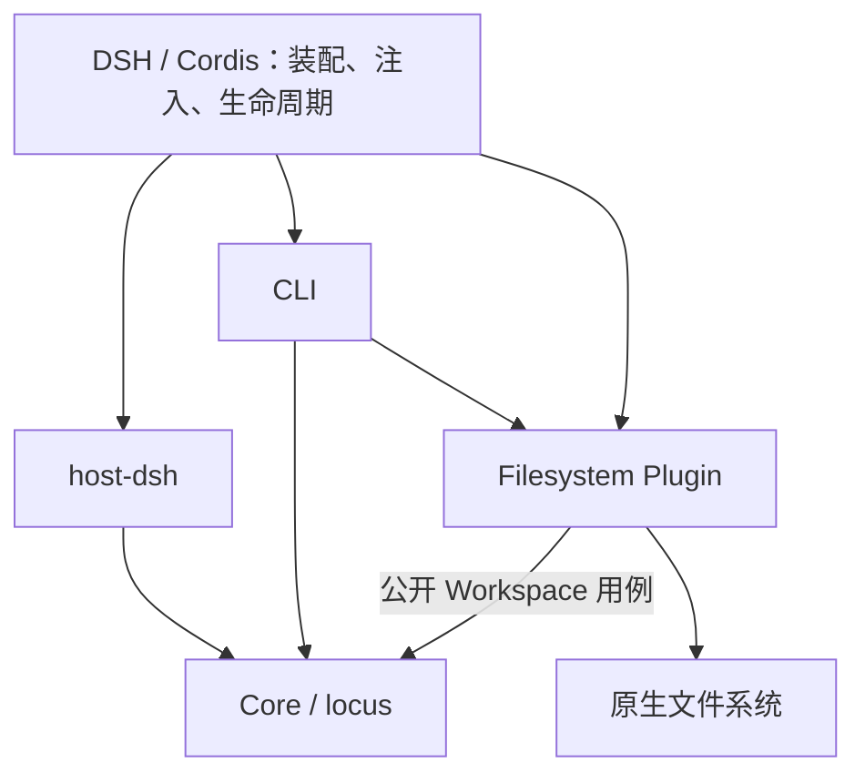

# 项目架构

改动 `packages/` 或 `plugins/` 下内容前先读本文。本文维护当前组件、依赖与扩展边界；决定理由在 Agent Notes，用法在模块 README，验证入口在[测试系统](testing.md#分层与入口)。

## 当前交付与方向

Workspace Foundation 已交付：独立于目录/Project/Session 的长期 Workspace，持久身份与显式成员/关联；Filesystem 的多位置登记、按需发现与读取；该能力只保存位置配置，确认后的长期关系由 Core 保存。CLI 在项目内 DSH profile 提供用户入口，重启、能力缺失和资源消失不删除长期关系。

本仓库刚完成方向重定位后的精简：删除 Operation Catalog、Workspace Capability 选择、Application Composition、UI 与 Git/Session/Remote Machine/Connectivity/Gitea 插件，保留宿主、Core、CLI 与 Filesystem。原因与重新引入条件见[精简决定](../.agents/notes/implemented/simplification/2026-11-12-prune-plugin-machinery.md)。后续按具体应用逐个重配领域，不预建通用能力生成、契约 DSL、中央注册表或第二套运行时。

产品方向以[方向重定位与架构基线](../temp/history/3-方向重定位与架构基线.md)为背景材料；该文件不参与文档检查，也不作为运行依赖。

## 组件与依赖

| 路径 | 当前职责 |
| --- | --- |
| `packages/contracts/` | 当前真实生产者/消费者共享的最小类型：Workspace、关系与 Filesystem 局部协议；无 DSH/Cordis 或运行逻辑 |
| `packages/core/` | Workspace 身份、长期成员/关联与必要来源；自有持久数据，不解释领域引用 |
| `packages/host-dsh/` | 创建/持有 Core，提供 `locus` 并随 fiber 释放 |
| `plugins/filesystem/` | 位置登记与本机引用、范围、原生状态、单层发现和有界读取；自有配置 |
| `plugins/cli/` | 参数/帮助、用例编排、显式确认、人类/JSON 渲染与退出；不实现领域 I/O 或跨领域组合 |
| `tests/`、`scripts/` | 隔离真实资源测试及实际 profile 验收，不成为业务运行依赖 |

下图表示运行时调用/装配，类型依赖统一经 contracts；不表示所有能力都要由 Core 转发。

编译依赖：Core 仅 Node 与 contracts；host 依赖 Core/contracts 和 Cordis 类型；CLI 与 Filesystem 不依赖 Core 实现包。DSH 是当前唯一宿主，不预建 Host 抽象、专用 Host 或独立业务运行时。

## 宿主与扩展边界

- `locus` 由 host 唯一提供；领域 Plugin 直接提供当前需要的服务，随 fiber 撤销，不占用无关 DSH 顶层名字。
- Filesystem 使用 `locusFilesystem`，只消费公开 Workspace 用例；不复制 Core 的身份或关系模型。
- CLI 的 `shell` 只是同一 CLI 插件内的长驻命令循环，复用现有命令树、领域服务和持久化；开发期 HMR 仍由 DSH/Cordis 管理模块与 fiber。
- 领域服务可以在缺少 Plugin 时明确失败；已保存的长期关系与领域配置保留。
- 不预建 Capability 注册表、能力选择门禁、Operation Catalog、插件命令生成器或应用组合框架。新增领域按具体应用需要接入，直接使用 TypeScript 模块、Cordis 服务和 CLI 命令。

## 技术与数据

| 范围 | 当前选择与限制 |
| --- | --- |
| 工程 | TypeScript、Node.js、ESM、pnpm Workspace；实际环境与命令见[开发与验证](development.md) |
| 宿主 | 项目内 DSH `0.2.1-rc.5` + Cordis，既有 `locus` profile，`link:` + patch |
| 持久化 | 内置 SQLite：Core 与 Filesystem 各自独立库，实验版本 1；不规定后续领域的最终载体 |
| 领域读取 | Node 文件系统；观察结果不持久化，不取代外部事实权威 |
| 验证 | 内置 Node 测试 + 真实 DSH profile；不引入额外业务测试框架或用文档检查代替业务证据 |

数据所有权与物理位置独立。Core 保存长期身份、确认关系与不透明引用，Plugin 解释领域规则；外部对象不可达不等于关系不存在。备份在停止全部写者后复制整个数据目录，原生资源和授权不隐含包含；版本、恢复与清除约定见 [Core](../packages/core/README.md#持久化与恢复)与 [Filesystem](../plugins/filesystem/README.md#数据与生命周期)。

## 控制与演进

构建、Core 边界与装配的事实分别由[开发与验证](development.md)、[Core](../packages/core/README.md)与 [Host-DSH](../packages/host-dsh/README.md)维护；长期取舍由 Agent Notes 承载，控制面只服务临时任务，收尾后删除。

只有实际交付且验证的行为进入 implemented；未交付方向遵循 [Agent Notes 生命周期](../.agents/notes/AGENTS.md#在生命周期之间移动)。防御集中于实际输入与故障边界，不为假想异常增加重复校验、静默回退或通用抽象。
